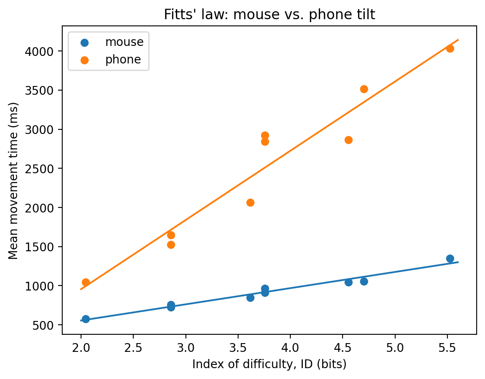
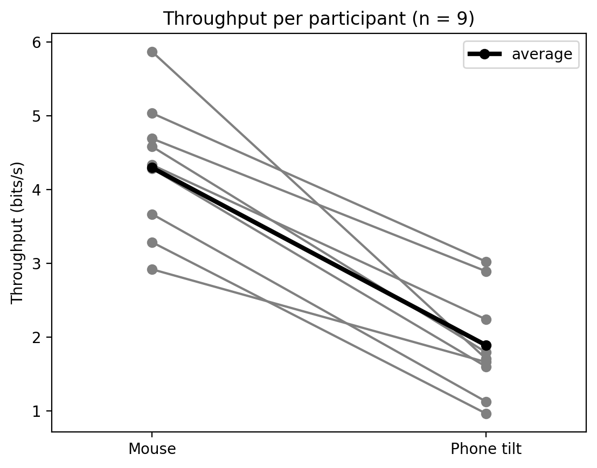
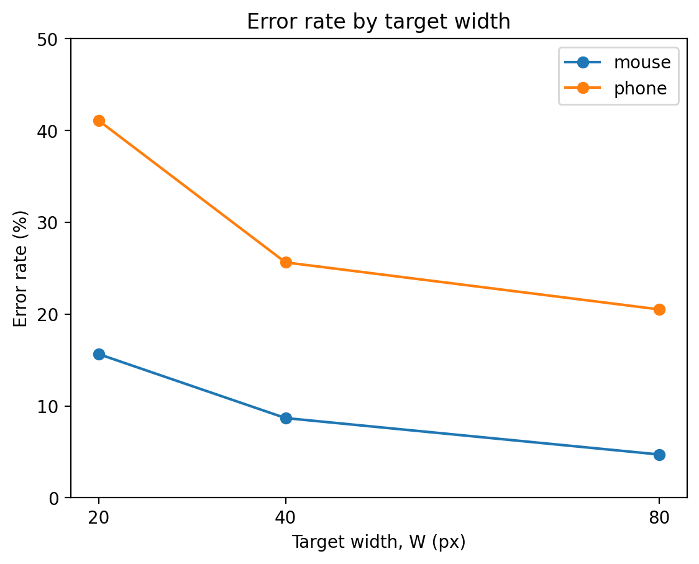

# Mouse vs. Phone Tilt: A Fitts' Law Pointing Study

For first-time users, phone-tilt pointing reached **37% of mouse/trackpad effective throughput** (1.61 vs. 4.30 bits/s) in a reciprocal tapping experiment, and **all 9 participants who used both devices were faster with the mouse/trackpad**. The phone's cost grew with difficulty, especially for small targets.

This repository contains the experiment (in Processing and in the browser) and the analysis in Python. The raw data is not included (see [Privacy](#privacy)).



---

## Motivation and research question

I had previously built a creative project that used a phone's tilt sensor (via ZigSim) to control visuals in Processing. Here I turned that idea into an input technique and evaluated it the way HCI research evaluates pointing: with a controlled experiment and Fitts' law.

**Research question:** how does phone-tilt pointing compare with a mouse or trackpad in speed, accuracy and throughput?

The mouse/trackpad is the **baseline**. A phone throughput number means little on its own; next to the mouse it becomes a comparison. The mouse data also checks the setup: if it follows Fitts' law and lands in the range other studies report, the remote task is measuring pointing.

## Method

**Task.** A reciprocal tapping task (as in Fitts, 1954). Two circular targets sit side by side; the highlighted one must be selected, then the other, back and forth. Each hit ends one trial; movement time (MT) is the time since the previous hit. Selections outside the target are recorded as errors, and the timer keeps running through them. Participants were asked to work "as quickly and accurately as you can".

**Conditions.** On a 1200 × 600 logical canvas:

| | Values |
|---|---|
| Distance A (centre to centre) | 250, 500, 900 px |
| Target width W (diameter) | 20, 40, 80 px |
| Combinations | 9, index of difficulty ID = log₂(A/W + 1) from 2.04 to 5.52 bits |
| Hits per combination | 10 (after one unrecorded start click) |
| Rounds per device | 1, conditions in random order |
| Practice | 2 short sets of 3 hits, not recorded |

**Devices.**
- **Mouse or trackpad:** participants used their own computer and reported which.
- **Phone tilt:** the phone is a controller; the targets stay on the computer screen. Tilting the phone moves a cursor (position control), and tapping anywhere on the phone's screen selects.

**Design.** Within-subjects: each participant used both devices. Device order was meant to be counterbalanced by participant code; in practice 7 started with the mouse and 2 with the phone. No hover feedback was shown on either device, and the mouse was ignored in phone mode, so both devices got the same visual information.

**Participants.** 11 people took part remotely in the browser on 26 October 2026, identified only by random codes. 2 participants completed only the mouse part and are excluded from the analysis, which covers the 9 who used both devices (4 with a mouse, 5 with a trackpad).

**Pilot.** The task was piloted in the Processing version. The pilot led to three decisions: one round per device instead of two, the speed-and-accuracy instruction, and the double-tap cleaning rule.

## Implementation

**Processing version** (`experiment/`): the prototype, used for the pilot. Built around four small classes:

| Class | Responsibility |
|---|---|
| `Target` | Position and diameter; draws itself; `contains(x, y)` tests whether a point is inside |
| `Trial` | One selection's data; computes its own ID |
| `Condition` | One A/W combination |
| `Study` | Builds and shuffles the 9 conditions and steps through them |

Both devices write into one shared pointer, and all selection logic lives in one function, so the experiment is identical for both; only the input differs. The phone sends gravity and touch data over OSC (ZigSim, oscP5).

**Browser version** ([try it live](https://amannn17.github.io/pointing-study_remote/) · [source](https://github.com/amannn17/pointing-study_remote)): the version that ran the study. **All study data came from this version.** It is a port of the Processing version to one HTML file, hosted with GitHub Pages, so other people could take part with their own computer and phone:
- The computer shows a QR code; the phone opens it and connects directly to the computer (WebRTC via PeerJS).
- The phone reports its tilt (DeviceOrientation, in degrees) and taps; the computer does all the calculation.
- Each person's data is sent to a Google Sheet (Apps Script) and only reported as saved once the sheet confirms it, with a download as backup.

**Phone input details.**
- **Mapping:** ±30° of left/right tilt and ±17.5° of forward/back tilt cover the canvas, about 20 px per degree horizontally and 17 px per degree vertically. Tilting the top edge toward you moves the cursor up.
- **Calibration:** the participant's comfortable holding angle becomes the centre.
- **Smoothing:** each frame, the cursor moves 25% of the way to the raw tilt position (frame-rate independent), which cuts sensor jitter at the cost of a small lag.
- **Selection:** one selection per tap (edge detection), so holding a finger down doesn't select repeatedly.

## Analysis

The analysis is in two Jupyter notebooks in `analysis/`. All cleaning rules were fixed before comparing the devices.

**Cleaning** (`clean.ipynb`, all 11 participants), then filtered to the 9 pairs at the start of `analysis.ipynb`:

| Step | Rows |
|---|---|
| Raw data, 11 participants | 2,456 selections |
| Remove 29 double taps (a miss < 250 ms after a hit, landing on the just-hit target; all on the phone) | 2,427 selections |
| Keep the 9 participants who used both devices | 2,233 selections (used for error rate) |
| Hits only | 1,620 |
| Drop the first movement of each condition (a "getting going" delay) | 1,458 |
| Remove outliers: MT > 3 × the median for that person, device and condition (14, 1%) | 1,444 hits (used for timing) |

I used a median-based outlier rule because a 3-standard-deviation rule cannot work with about ten values per condition: an extreme value inflates the standard deviation meant to catch it.

Two data fixes, both in code with the raw file untouched: one participant who restarted under a new code was merged with their first code (flagged by an identical, unusual screen scale and confirmed with the person), and one overwritten cell was corrected.

**Measures** (`analysis.ipynb`).
- **Fitts' law fit:** mean MT per person and condition, averaged across people, then MT = a + b × ID per device. R² is fitted to the 9 condition means, not to individual trials.
- **Throughput:** ID / MT per condition, averaged per person and device.
- **Effective throughput (TPe), the headline measure:** the effective width We = 4.133 × SD of selection positions along the movement axis, so a fast but inaccurate participant is scored as having used a larger target. The effective ID uses the nominal distance A: IDe = log₂(A/We + 1). Selections that landed nearer the other target (12) were left out of the spread.
- **Paired t-test** on each person's mouse vs. phone score (exploratory, given the sample size).
- **Error rate:** misses / all selections, averaged per participant, per device and per target width.

Two cleaning choices favour the phone: removing the 29 double taps lowers its error rate, and leaving the 12 wrong-side selections out of the spread narrows its effective width.

## Results

All values are for the 9 participants who used both devices.

| | Mouse/trackpad | Phone tilt |
|---|---|---|
| **Effective throughput (TPe)** | **4.30 bits/s** | **1.61 bits/s** (37%) |
| Throughput (TP) | 4.30 bits/s | 1.89 bits/s |
| Fitts' law fit | MT = 141 + 207 × ID | MT = −814 + 885 × ID |
| R² (condition means) | 0.97 | 0.93 |
| Error rate, averaged per participant | 10.4% | 32.1% |
| Errors at W = 20 / 40 / 80 px | 16% / 9% / 5% | 41% / 26% / 21% |
| Effective width at W = 20 / 40 / 80 px | 22 / 41 / 79 px | 56 / 66 / 117 px |
| Easiest / hardest condition | 578 / 1,351 ms | 1,044 / 4,035 ms |

**All 9 participants were faster with the mouse/trackpad.** Mean paired difference in TPe: 2.69 bits/s (paired t(8) = 10.73, p < .001; exploratory).



**The phone's cost grows with difficulty.** Each extra bit of difficulty cost about 207 ms with the mouse/trackpad and 885 ms with the phone. The phone took 1.8 times as long on the easiest condition and 3.0 times as long on the hardest.

**Small targets hurt the phone most.** Even the largest phone targets were missed more often (21%) than the smallest mouse targets (16%).



**Robustness checks.** The result held when restricted to real-mouse users (n = 4, difference 2.81 bits/s) and without the least accurate participant (n = 8, difference 2.64 bits/s); every person in each subset was faster with the mouse.

**Context.** Other studies compared their devices with their own mouse, so the fair comparison is the distance from each study's baseline:

| Study | Mouse | Device | vs. own mouse |
|---|---|---|---|
| MacKenzie & Jusoh 2001 | 3.7 | GyroPoint, in the air: 2.8 | ≈ −24% |
| MacKenzie & Jusoh 2001 | 3.7 | RemotePoint: 1.4 | ≈ −62% |
| Natapov et al. 2009 | 3.78 | Wii Remote: 2.59 | −31.5% |
| Natapov et al. 2009 | 3.78 | Classic Controller: 1.48 | −60.8% |
| This study | 4.30 | Phone tilt: 1.61 | −63% |

Phone tilt landed with the joystick and thumbstick devices, not with the other wrist-driven pointers. This is context only: those were in-lab studies with several practice blocks.

## Discussion

**The mouse/trackpad data behaved as expected, which suggests the remote setup worked.** Its line fits the condition means closely (R² = 0.97), and 4.30 bits/s is comparable to the 3.7–4.9 bits/s reported in ISO 9241-9 studies of the mouse (Soukoreff & MacKenzie, 2004). Comparable rather than equivalent: this task is one-dimensional, one round, and uses nominal A in IDe.

**For first-time users, phone tilt was much slower**, at 37% of mouse/trackpad effective throughput. The gap is not constant: it widens as targets get smaller and further away.

**The mapping looks like the bottleneck.** On 20 px targets, phone selections had an effective width of 56 px. At about 20 px per degree, that is roughly 2.8° of wrist spread for a target 1° wide. That phone tilt performed like the joystick devices rather than the other wrist-driven pointers points the same way: the gain and mapping, more than the wrist itself.

**Small targets cost the phone more than Fitts' law predicts.** Two phone conditions with almost the same ID took very different times: A = 900, W = 80 (ID 3.61) took 2,067 ms, while A = 250, W = 20 (ID 3.75) took 2,844 ms, 38% longer. The mouse/trackpad rose 14% (849 to 966 ms). This is an observation from two condition means, not a test. The phone's negative intercept is not meaningful in itself; it comes from extending a steep line below the tested range.

**Effective throughput widened the gap** (from 2.41 to 2.69 bits/s), because plain throughput gave the phone credit for speed without charging for its many misses.

**No clear evidence of a "Heisenberg effect"** (Bowman et al., 2001), where the act of selecting moves a tracked device off the target. Phone selections landed on average 2.3 px below the target centre, against 0.5 px for the mouse/trackpad (7 of 9 vs. 5 of 9 participants leaning down), which is small next to a vertical spread of about 14 px. Phone selections were, however, 2.8 times as scattered along the movement axis.

### Limitations

- **First use only:** one round with 6 practice hits measures novice performance, not what the technique can reach. MacKenzie and Jusoh (2001) make the same caveat about their own novice participants.
- **Small sample:** 9 complete pairs. The direction is very consistent, but the exact sizes are uncertain.
- **Unbalanced device order:** 7 people started with the mouse and 2 with the phone. Learning would favour the phone and fatigue would work against it; with this order the two can't be separated.
- **Uncontrolled setups:** remote sessions on participants' own screens (different physical sizes), mice and trackpads, phones and Wi-Fi. Phone taps travel over the network, adding a few milliseconds.
- **Phone input design choices:** the tilt range, smoothing (which adds a small lag) and calibration all affect performance; the results describe this mapping, not phone tilt in general.
- **Heisenberg check is indirect:** only the cursor position at the moment of selection was logged.

### What I'd do next

- **Gain and rate control:** compare position control at several gains with a gyroscope-based "air mouse" (rotation speed moves the cursor), over several practice sessions. Log the cursor position about 100 ms before each tap to measure the Heisenberg effect directly (see Wolf et al., 2020, for a formal evaluation in VR).
- **Gaze + tilt:** gaze moves the cursor near the target, tilt does the final adjustment and a phone tap selects. Does movement time still depend on A/W, as Fitts' law predicts, or only on W? This builds on Look & Touch (Stellmach & Dachselt, CHI 2012).
- **Effort, not just speed:** longer term, an EEG headset (Emotiv EPOC X) could add head tilt as a third pointer and, with a workload questionnaire (NASA-TLX) as the main measure, show whether tilt is also more mentally demanding.
- **Smaller fixes to this study:** make the page enforce the device order, and run more participants, some in person on the same equipment.

## How to run it

**Browser version.** Open the [study page](https://amannn17.github.io/pointing-study_remote/) on a computer and follow the steps. For the phone part, scan the QR code with a phone on the same Wi-Fi. Data saving needs a Google Apps Script web app (`doPost` writes rows to a Sheet), deployed as *Execute as: Me, Who has access: Anyone*; put its `/exec` address in `CONFIG.endpoint` in `index.html`.

**Processing version.**
1. Install the **oscP5** library.
2. In ZigSim, enable **Gravity** and **Touch**, set the port to **9000** and the message rate to 60 per second; phone and computer on the same Wi-Fi.
3. Open `experiment/experiment.pde` and run it. Type a participant code, press **TAB** to choose the device, **Enter** to start (this also calibrates the phone). During the task: **C** re-centres the phone, **S** saves a backup. Data is saved automatically to `data/`.

**Analysis.** With Python, pandas, NumPy, SciPy and matplotlib installed, run `analysis/clean.ipynb`, then `analysis/analysis.ipynb`. Both expect your own data in `data/`, which is not part of this repository.

## Repository structure

```
experiment/     Processing sketch (main tab + Target, Trial, Condition, Study)
zigsim_test/    Tool used to record tilt values
analysis/       Cleaning and analysis notebooks, plots
```

## How this was built

I designed the study, wrote the Processing version, ran the pilot and the main study, and made the final call on every analysis decision. I used Claude, an AI assistant, throughout: it explained concepts, reviewed my code, helped me debug and challenged some of my analysis choices. It also generated the browser version from my Processing code and specification, which I tested and deployed, and it provided the analysis code cell by cell, which I ran, checked against expected outputs and can explain line by line.

## Privacy

Participants gave consent on the study's first page to take part in the study, not to data sharing, so the raw data isn't public; the analysis code and summary results are. Participants are identified only by random codes and no names are stored, but coded data that could be linked back to a person can still count as personal data under the GDPR.

## References

- Bowman, D. A., Wingrave, C. A., Campbell, J. M., & Ly, V. Q. (2001). Using Pinch Gloves for both natural and abstract interaction techniques in virtual environments. *HCI International 2001*.
- Fitts, P. M. (1954). The information capacity of the human motor system in controlling the amplitude of movement. *Journal of Experimental Psychology*, 47(6), 381–391.
- MacKenzie, I. S., & Jusoh, S. (2001). An evaluation of two input devices for remote pointing. *EHCI 2001*.
- Natapov, D., Castellucci, S. J., & MacKenzie, I. S. (2009). ISO 9241-9 evaluation of video game controllers. *Graphics Interface 2009*.
- Soukoreff, R. W., & MacKenzie, I. S. (2004). Towards a standard for pointing device evaluation, perspectives on 27 years of Fitts' law research in HCI. *International Journal of Human-Computer Studies*, 61(6), 751–789.
- Stellmach, S., & Dachselt, R. (2012). Look & touch: gaze-supported target acquisition. *CHI 2012*.
- Wolf, D., Gugenheimer, J., Combosch, M., & Rukzio, E. (2020). Understanding the Heisenberg effect of spatial interaction: a selection induced error for spatially tracked input devices. *CHI 2020*.
